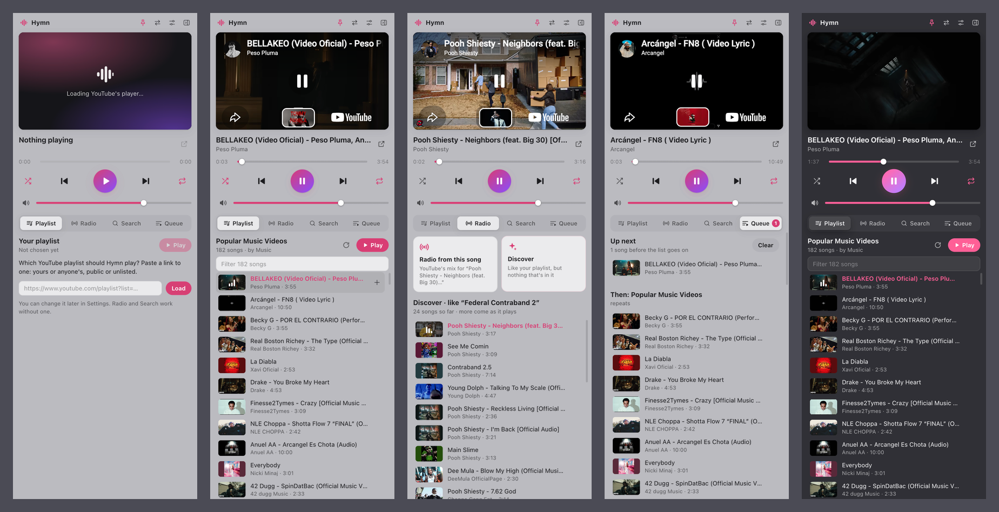

# Hymn

A sidebar music player for macOS. It docks to the edge of your screen, plays your YouTube playlist, and
keeps going with YouTube mixes ("radio"), search results or any YouTube link you paste. You control it from
the sidebar, the menu bar, global shortcuts and the keyboard's media keys.



## Get it

Download `Hymn-<version>-arm64.dmg` from [Releases](https://github.com/ragnox/hymn/releases) (Macs with Apple silicon) and drag Hymn to Applications. The app isn't notarized by Apple, so the first time macOS refuses to open it: open **System Settings → Privacy & Security**, scroll down to the message about Hymn, and click **Open Anyway**.

Or run it from the source (Node.js 22.13 or newer):

```bash
npm install
npm start
```

To build the app yourself (`dist/mac-arm64/Hymn.app`; `npm run dist` makes the DMG and zip):

```bash
npm run dist:dir
```

Hymn lives in the menu bar (the five-bar icon), not in the Dock. Quit it from there, or with ⌘Q in the sidebar.

## What it does

**Four sources**, as tabs:

- **Playlist**: a YouTube playlist of your choice: on the first start Hymn asks for a link to one (yours or anyone's, public or unlisted); change it in Settings. Click a song to play it, **+** to put it in Up next, and type to filter (accents don't matter: "noel" finds "Noël"). ↻ reloads it from YouTube; it also reloads by itself about once an hour, without disturbing the shuffled round you're in.
- **Radio**: *Radio from this song* plays YouTube's mix for what's playing. *Discover* plays songs that YouTube mixes with random songs of your playlist, leaving out the ones you already have. Both keep going: more songs are added as it plays.
- **Search**: any song on YouTube. A song you pick keeps going as a radio, and *Play all* plays the results in order. Paste a link instead of a search: a video plays (then its mix), a playlist plays from the start, and a video in a playlist plays that playlist from that video. `youtu.be`, `music.youtube.com`, Shorts and `&t=` links work too.
- **Queue**: Up next (songs you added with +) and what comes after it.

**Controls**: play/pause, previous (restarts the song after 3 s), next, shuffle (each song once per round, never the same twice in a row), repeat (all → one → off), seek, volume. Hymn remembers all of this, and after a restart it has the same song ready, paused where it was.

**Keys in the sidebar**: Space play/pause · ←/→ 10 s back/forward · ⇧←/⇧→ previous/next · N next · P previous · M mute · S shuffle · R repeat · / or ⌘F search · 1–4 tabs · ⌘, settings · Esc closes settings.

**Global shortcuts** (they work while other apps are in front; change them in Settings by clicking one and pressing new keys):

| | |
|---|---|
| ⌃⌥⌘P | play / pause |
| ⌃⌥⌘→ | next song |
| ⌃⌥⌘← | previous song |
| ⌃⌥⌘H | show / hide the sidebar |

**Media keys** (⏮ ⏯ ⏭) and macOS's Now Playing should control Hymn while it's the app playing; see the notes at the end.

**The window**: drag it by its top bar and drop it, and it snaps to the nearer edge of whichever screen it's on. Drag its inner edge to make it wider (380–600 px). The buttons at the top: keep on top · move to the other side · settings · hide. In Settings you can also turn on **Hide when the mouse leaves**: the sidebar slides away when the mouse moves off it, and back when the mouse rests against that screen edge. Other settings: show on every desktop (Space), the song's title in the menu bar, and open at login (in the built app).

**Videos that won't play**: some videos can't be played outside YouTube: their owners don't allow it, or they're age-restricted. Hymn skips those, greys them out, and offers *Open on YouTube*. A video that doesn't start within 30 s is skipped too, and after 5 failures in a row (no connection?) Hymn stops instead of racing through the list. Settings → *Try again* forgets the list. YouTube may also show ads before a video, as it does on any site that embeds its player.

## How it works

- **Playing** uses YouTube's own embedded player (the [IFrame Player API](https://developers.google.com/youtube/iframe_api_reference)), with Hymn's own controls. The player runs in a frame of its own (`app://player`, [src/player](src/player/frame.js)) that the sidebar drives by messages, so YouTube's scripts never run next to the app's API. YouTube only plays embedded videos for a page that identifies itself; an app without a web address does that with an `https://<app id>` Referer (`https://io.github.ragnox.hymn/`), as YouTube asks of apps.
- **Lists** (playlist, search, mixes, related videos) come from the JSON endpoints youtube.com's own pages use, without an API key or a sign-in. That means **public and unlisted playlists only**. These endpoints aren't a documented API and can change; all parsing is in [src/main/youtube.js](src/main/youtube.js) and is tested against saved answers in `test/fixtures` (`node scripts/record-fixtures.js` records fresh ones, without anything that identifies who recorded them).
- **Memory**: YouTube's player grows by several MB with every song. Hymn swaps it for a fresh one every 20 songs, alternating between `youtube.com` and `youtube-nocookie.com` so each new player gets a new process and the old one ends (checked with `test/ui/soak.js`).
- **Security**: the sidebar page has no Node access (context isolation, sandbox) and runs only its own scripts (Content Security Policy); YouTube's run in the separate player frame, which can't reach the page. The page talks to the main process only through a small API ([src/preload/preload.cjs](src/preload/preload.cjs)), and the main process checks what it's given: settings and shortcuts are validated (a shortcut must have ⌃, ⌥ or ⌘, or be a function key, so it can't swallow your typing). Links open in your browser only if they're YouTube links, and no page can ask for any permission.
- **Your data** stays in `~/Library/Application Support/Hymn`: `settings.json`, `state.json` (what's playing, the queue, videos that won't play) and `cache/` (your playlist, for a fast start).

```
scripts/        icons, the macOS build, fixture recording
src/main/       main process: window (sidebar.js), menu bar, shortcuts, settings, YouTube data (youtube.js)
src/preload/    the bridge between page and main process
src/renderer/   the sidebar page: app.js (UI), player.js (talks to the player frame), queue.js (what plays next), media-session.js
src/player/     the player frame: YouTube's embedded player, on an origin of its own
src/shared/     link parsing and formatting, used by both sides
test/           unit tests; test/ui/ runs the whole app hidden and muted against live YouTube
```

## Tests

```bash
npm test
```

```bash
npm run test:ui
```

`npm test` runs the unit tests: parsers, queue, settings, docking geometry, auto-hide, menu, shortcuts. `npm run test:ui` starts the real app with a hidden window, muted, on a throwaway profile, without a menu-bar icon or global shortcuts. It clicks and types its way through choosing a playlist (a public one of YouTube's own Music channel), playing, seeking, shuffle/repeat, filter, Up next, a blocked video, search, radio, discover, links, docking and snapping, width, shortcuts, auto-hide, a restart and the player frame's isolation, against live YouTube. It takes about 30 s. Set `HYMN_UI_SCREENSHOTS=<folder>` to keep screenshots, and `HYMN_APP=dist/mac-arm64/Hymn.app/Contents/MacOS/Hymn` to test the built app instead of the sources. `node test/ui/soak.js 60` plays 60 songs back to back and prints each process's memory.

## Notes

- The media keys and Now Playing aren't covered by the tests (they need real key presses). Hymn plays a silent sound in its own page, so that the system sends media keys there and not to YouTube's player frame (where "next" means nothing). If they don't reach Hymn on your Mac, the global shortcuts always work.
- Without a Developer ID certificate the built app is signed ad hoc: it opens on this Mac. Another Mac asks before opening it the first time.
